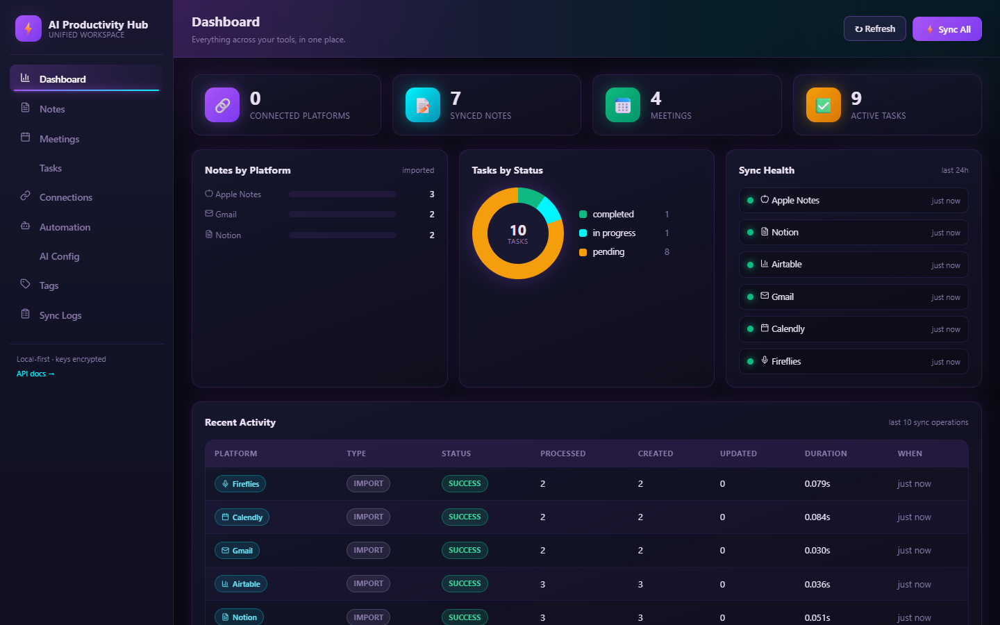
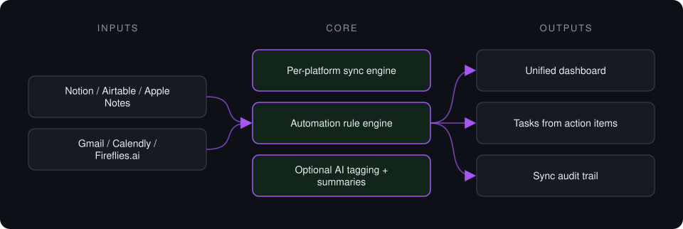

# AI Productivity Hub

**Pulls notes, meetings and tasks from Apple Notes, Notion, Airtable, Gmail, Calendly and Fireflies.ai into one dashboard with automation rules.**

> **This is a proprietary project. Source code is private. This page showcases the system's architecture and results.**

**Case study page:** [https://jryahia.github.io/showcase-ai-productivity-hub/](https://jryahia.github.io/showcase-ai-productivity-hub/)

## Problem it solves

Notes, meetings and tasks live in six different tools. This hub syncs them into one place, turns meeting action items into tasks automatically, and tags content, with or without an AI key.

## Architecture

1. Scheduled syncs fetch, normalize and upsert items from each platform.
2. Automation rules react to triggers such as completed meetings or keywords.
3. Items are tagged and summarized, with local fallbacks when no AI key is set.
4. Everything shows on one dashboard with sync health.

## Key features

- Six platform connectors
- Rule engine with five triggers and four actions
- Credentials encrypted at rest
- Degrades gracefully without an AI key
- Kanban and table task views
- Full config backup and restore

## Tech stack

     

## What it does in practice

- Meeting action items become tracked tasks without copy-pasting.

## Screenshots

**Cross-platform dashboard after sync**

---

Built by [Yahya Jarray](https://github.com/jryahia). Interested in a similar system? [Get in touch](mailto:yahiajarray43@gmail.com).
